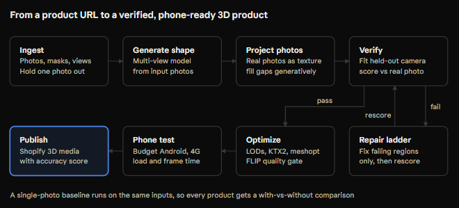

# Proof3D

**Verified 3D products from the photos merchants already have.**

Single-photo 3D generation invents every surface the photo doesn't show, and nothing proves the result matches the real product. Most listings already have 4 to 8 photos from different angles. Proof3D uses them twice: most build the model, and one is held back to *prove* the model is right. It fits a camera to that unseen photo, renders the model from it, and scores the difference.



> **Status: week 1 of 4.** The geometry core (camera fitting, rasterisation, failure regions), the typed pipeline contracts, and the API with its job queue are built and tested. The model-backed stages are not built yet. See [build status](docs/architecture.md#build-status). This README never claims more than that table.

## Quickstart

Requires [uv](https://docs.astral.sh/uv/) and, for the local stack, Docker.

```bash
git clone https://github.com/PavanSiddapuram/proof3D.git && cd proof3D
uv sync                 # Python 3.12 workspace, pinned by uv.lock
uv run pytest           # unit, property and API tests (~1 min on a laptop CPU)
make up                 # Postgres + API + CPU worker; API docs at http://localhost:8000/docs
                        # (port taken? PROOF3D_API_PORT=8001 make up)
```

Try the camera fitter on its own:

```python
from proof3d_geometry import OrbitPose, fit_camera, orbit_camera, rasterize, rotation_angle_deg
import trimesh

mesh = trimesh.creation.box(extents=[1.0, 0.4, 0.2])
truth = orbit_camera(OrbitPose(azimuth_deg=40, elevation_deg=20, distance=3), 160, 120)
mask = rasterize(mesh.vertices, mesh.faces, truth).mask  # stand-in for a photo mask

fit = fit_camera(mesh.vertices, mesh.faces, mask, view_label="three_quarter_left")
print(fit.iou, fit.ambiguous, rotation_angle_deg(fit.camera.R, truth.R))
```

This prints roughly `0.98 False 0.7`: silhouette IoU, no ambiguity, and 0.7° rotation error. A box *is* symmetric, but its identical-silhouette twin is 180° away, outside the search window around the three-quarter-left prior. Search the whole orbit (`view_label="close_up"` or `None`) and the fitter flags `ambiguous=True` instead of silently picking one. When it fits badly it sets `low_iou=True` and the photo is not scored.

### Check a model from any generator

`eval/scripts/check_model.py` checks any GLB, for example a VersaAI, Tripo or Rodin output, against background-removed PNGs of the product. It runs on CPU. Mark the photos the generator never saw with `--held-out`:

```bash
uv run python eval/scripts/check_model.py model.glb \
    --photo front.png:front --held-out left.png:left --held-out top.png:top
```

On a synthetic test: the true product was photographed from the front, left and top, and a model got the depth wrong (an arm pointing at the camera was too long). The model still matches its input photo (IoU 0.904), but the held-out photos expose it:

```
  held-out left.png    silhouette IoU 0.517  shows  0.0% of surface DISAGREES
  held-out top.png     silhouette IoU 0.767  shows  0.0% of surface DISAGREES
Result: DISAGREES with held-out left.png, top.png
```

The correct model scores 0.98 or higher on all three photos. For it, the check also reports that 47.9% of the surface appears in no photo, and suggests the right side as the next photo (+25.9%). Only silhouettes are scored so far; appearance metrics need the GPU worker.

### Run it end to end

The same check runs as pipeline stages: upload, import, ingest, verify, scorecard. It goes through the API, the Postgres queue and storage. With Postgres running and `PROOF3D_DATABASE_URL` set in `.env`:

```bash
uv run python -m proof3d_api.migrate                    # create or upgrade the schema
uv run uvicorn proof3d_api.main:create_app --factory    # terminal 1: the API
uv run python eval/scripts/demo_verify.py --wrong       # terminal 2: upload, import, verify
```

The demo builds a synthetic product, uploads three photos and a model with `POST /uploads`, imports the model with left and top held out, and runs the GPU worker's queue in-process. Ingest and verify run on CPU today. It then prints the job and the scorecard from the API. With `--wrong`, the model's depth is wrong:

```
  ingest           succeeded     0.1 s
  verify           succeeded    29.0 s
  optimize         queued
Verdict: disagrees
  held-out left.png: silhouette IoU 0.552  DISAGREES
  held-out top.png: silhouette IoU 0.674  DISAGREES
  input    front.png: silhouette IoU 0.905
```

Without `--wrong`, the verdict is `silhouette_agrees`, with held-out IoUs of 0.963 and 0.994. The job then waits at `optimize`, which is not built yet. To run the worker separately, use `--no-worker`, then run `PYTHONPATH=services/worker-gpu/src uv run python -m proof3d_worker_gpu --drain`.

## Repository

| Path | What |
|---|---|
| [packages/geometry](packages/geometry) | Cameras, CPU rasteriser, camera fitting, failure regions, mesh checks |
| [packages/pipeline](packages/pipeline) | Stage order, typed results, Pydantic configs, provenance, storage |
| [services/api](services/api) | FastAPI orchestrator, data model, Postgres-backed queue, worker loop |
| [services/worker-gpu](services/worker-gpu), [services/worker-cpu](services/worker-cpu) | Stage workers |
| [apps/web](apps/web), [packages/viewer](packages/viewer), [harness/phone](harness/phone) | Dashboard, viewer, phone runs (planned) |
| [eval](eval) | Configs, dataset manifest, results, `make report` |
| [docs](docs) | [PRD](docs/prd.md), [architecture](docs/architecture.md), [ADRs](docs/adr), [standards](docs/engineering-standards.md), [licence register](docs/licence-register.md) |

## Development

```bash
make setup      # uv sync + pre-commit hooks (ruff, mypy strict, gitleaks)
make lint typecheck test
make cov        # >= 80% on packages/geometry and packages/pipeline
make migrate    # create or upgrade the database schema (Alembic)
make api        # the API on :8000
make demo       # upload, import and verify a synthetic model through the API
make worker-gpu-local  # run queued GPU-worker stages here, then exit
make gpu-drain  # process queued GPU stages on Modal, then exit (docs/gpu.md)
make report     # rebuild results tables from eval/results/
```

Configuration comes from environment variables only. Copy `.env.example` to `.env`.

GPU stages run on free tiers: Kaggle for development, Modal for TRELLIS.2 and scored runs ([ADR 0006](docs/adr/0006-gpu-compute.md)). Setup steps are in [docs/gpu.md](docs/gpu.md).

## Licence

Code: [MIT](LICENSE). Third-party models have their own terms, tracked in [docs/licence-register.md](docs/licence-register.md); several are unverified, and one (nvdiffrast) is reportedly non-commercial.
