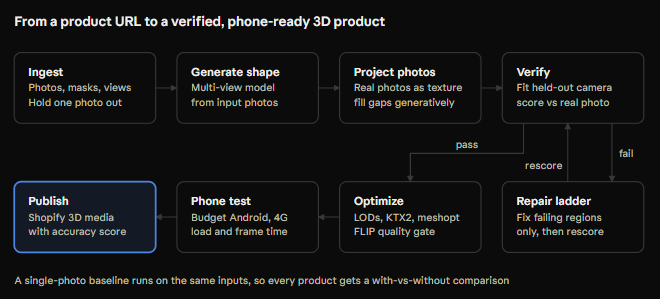

# Architecture



Requirements live in [prd.md](prd.md); how code is built in [engineering-standards.md](engineering-standards.md); decisions in [adr/](adr/).

## Components

```
              ┌────────────┐   HTTP    ┌──────────────────────┐
  browser ───▶│  apps/web  │──────────▶│  services/api        │
              └────────────┘           │  FastAPI + Postgres  │
                                       │  stage_runs = queue  │
                                       └───────┬──────────────┘
                     claim (FOR UPDATE SKIP LOCKED) │
             ┌──────────────────────────────────────┼──────────────────────┐
             ▼                                      ▼                      ▼
  ┌──────────────────────┐             ┌──────────────────────┐  ┌──────────────────┐
  │ services/worker-gpu  │             │ services/worker-cpu  │  │  harness/phone   │
  │ ingest, generate,    │             │ optimise, publish,   │  │  device runs     │
  │ project, verify,     │             │ repair rungs 1-2     │  └──────────────────┘
  │ repair controller    │             └──────────┬───────────┘
  │ on Modal or Kaggle   │                        │
  └──────────┬───────────┘                        │
             └──────────────┬─────────────────────┘
                            ▼
                 S3-compatible object storage (content-addressed keys)
```

The GPU worker runs on free tiers: Modal for TRELLIS.2 and scored runs, Kaggle for development ([ADR 0006](adr/0006-gpu-compute.md), [gpu.md](gpu.md)). There it runs with `--drain`: it processes every queued GPU stage and exits, so no paid time is spent polling. The database and bucket are hosted, so every process sees the same jobs and files.

Both workers import `packages/pipeline` (typed stage contracts, configs, storage) and `packages/geometry` (cameras, rasterisation, camera fitting, failure regions, mesh checks). The worker loop lives in `proof3d_api.worker` so both workers share claim, retry and recording logic.

## Build status

The table tracks what exists, so nobody reads a stage name as a working stage. A stage with no handler fails straight away with "The *X* stage is not built yet." It is never retried and never reports numbers.

| Piece | Status | Where |
|---|---|---|
| Stage contracts, configs, config hash, storage, self-measurement | Built, tested | `packages/pipeline` |
| Camera model and orbit poses | Built, property-tested | `packages/geometry/camera.py` |
| CPU rasteriser (mask, depth, face-ID) | Built, property-tested against a reference | `packages/geometry/raster.py` |
| Camera fitting from silhouette | Built, tested on known poses | `packages/geometry/camera_fit.py` |
| Failure regions from face-ID + error map | Built, tested | `packages/geometry/regions.py` |
| Mesh normalisation and checks | Built, tested | `packages/geometry/mesh.py` |
| Data model, API endpoints, Postgres queue, rerun | Built; unit-tested on SQLite, smoke-tested on Postgres 16 via Docker Compose | `services/api` |
| Worker loop (claim, run, retry, user-facing errors, `--drain`) | Built, tested | `services/api/.../worker.py` |
| S3-compatible storage | Built, tested against a fake client; not yet run against a real bucket | `packages/pipeline/storage.py` |
| Modal app for the GPU worker | Loads and builds its image definition locally; not yet run on a Modal account | `services/worker-gpu/modal_app.py` |
| Ingest (BiRefNet masks, view labels, hold-out choice) | Not built | week 1 |
| Shape generation A (TRELLIS.2) and B (Hunyuan3D-2mv) | Not built | week 1 |
| Verify: render + LPIPS / DINOv2 / FLIP / edges | Not built | week 2 |
| nvdiffrast backend for the rasteriser and fitter | Not built | week 2 |
| Texture projection (C) | Not built | week 3 |
| Repair rungs 1-2 (D) | Not built | week 3 |
| Optimise, phone harness, Shopify publish | Not built | week 4 |
| Web app, shared viewer | Not built | weeks 2-4 |

## Conventions

| Thing | Convention |
|---|---|
| World frame | glTF: y-up, right-handed, product centred at origin, front faces +z, longest bbox side = 1 after `normalize` |
| Camera frame | OpenCV: x right, y down, z forward |
| Pixels | Centre of pixel (i, j) is (i + 0.5, j + 0.5); a pixel is covered if its centre is inside or on a triangle edge |
| Orbit | Azimuth 0° = camera on +z (front). Positive azimuth orbits toward +x, the product's own left. Elevation positive above. Clamped to ±85° |
| View priors | front 0°, three-quarter-left 45°, left 90°, back 180°, right −90°, three-quarter-right −45°, top: elevation 75°. `close_up` and unknown labels search the full orbit |
| Storage keys | `prefix/sha256(content)[.ext]`, so manifests pin exact inputs and identical outputs dedupe |

## Camera fitting (PRD 5.4, step 1)

`fit_camera(vertices, faces, mask, view_label, settings)` returns the best camera, its silhouette IoU and two flags.

1. **Resize** the photo mask so its long side is `resolution` px. The resize is anti-aliased, so edge pixels keep fractional coverage.
2. **Coarse search** on an (azimuth, elevation) grid around the view-label prior. At each grid point, distance and principal-point offset are set in closed form, so the render's area and centroid match the mask. Product photos are rarely centred, and the offset absorbs that.
3. **Refine** the best `top_k` hypotheses that are more than 1.5 grid steps apart, using Nelder-Mead over (azimuth, elevation, roll, log distance, offset x, offset y). The objective is soft IoU between *coverage* maps: the render is supersampled `supersample`× and box-filtered. A binary silhouette is piecewise constant in the camera parameters and stalls a simplex search. Coverage changes continuously, and that change took rotation error from up to 12° to under 4° on the test poses.
4. **Polish** the winner with shrinking restarts.
5. **Flag:**
   - `low_iou`: the best IoU is below `min_iou` (0.85). The photo is not scored, because a bad fit would make the score measure the fit rather than the model.
   - `ambiguous`: another pose more than 25° away scores within 0.02 IoU. This is typical for symmetric products, the first risk in PRD §9.

**Constraints.** The camera stays at least 1.5× the bounding radius from the product. Without this, the optimiser chased an impossible target by moving inside the mesh. Focal length and distance are nearly degenerate for silhouettes, so FOV is held fixed unless `refine_fov` is set.

**What the tests establish (synthetic, CPU, 48-face chiral test mesh, 160×120 target, default settings):** four known poses, one from each of front, three-quarter-left, right and back, including off-centre framing and roll, are recovered within 5° of geodesic rotation error. In development runs the errors were 0.8° to 3.6°, at about 7 s per fit on a laptop CPU. A symmetric box is flagged ambiguous, and a target the mesh cannot explain is flagged low-IoU. At 96 px one pose converged 20° off, so 128 px is the default and the documented minimum. **None of this is a result on real photos yet.** Real accuracy comes from the eval on the photographed dataset.

**GPU path.** The worker will minimise the same objective with nvdiffrast's anti-aliased silhouettes, by gradient descent seeded from the same coarse search. The CPU path stays as the reference that CI tests.

## Failure regions (PRD 5.4, step 4)

`failing_regions(face_id, error, valid, faces, threshold)` works as follows. A face is failing when at least half of its visible, valid pixels exceed `threshold`, and it has at least `min_face_pixels` of them. Failing faces are grouped into connected components over edge adjacency, so repair gets one region per contiguous problem. `valid` comes from `agreement_mask`, the eroded intersection of the two silhouettes, so boundary misalignment is never blamed on the surface.

## Queue (ADR 0002)

Each job is eight `stage_runs` rows. Only one is `queued` or `running` at a time, and completing it queues the next. Workers claim with `SELECT … FOR UPDATE SKIP LOCKED`, filtered by worker kind. A crash is retried up to `max_stage_attempts`. A `StageError` carries a user-facing message and is not retried unless marked retryable. `rerun?from=stage` resets that stage and everything after it, and refuses (409) while a stage is running or an earlier stage has not succeeded.

## Reproducibility

Every `AssetVersion.provenance` carries the `Provenance` model: git commit, pipeline version, config hash, seed, dataset manifest version, model versions with weight hashes, GPU and driver. Configs are YAML in `eval/configs/`, validated with `extra="forbid"`, so a typo fails loudly. `make report` rebuilds every table from `eval/results/`.
