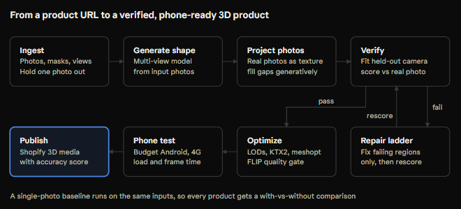

# PRD: Proof3D

Verified 3D products from the photos merchants already have.

| Field | Value |
|---|---|
| Owner | Pavan |
| Type | Technical PRD and end-to-end system design |
| Status | Draft, build before showing |
| Timeline | 4 weeks, one engineer |
| Supersedes | ReachBench (kept as a later tab; its optimizer and phone harness are reused here) |

## 1. Problem

Single-photo 3D generation invents every surface the photo does not show, and nothing in the pipeline proves the result matches the real product. In commerce that matters: the shopper is deciding whether to buy that exact item.

Most product listings already carry 4 to 8 photos from different angles. Proof3D uses them twice: some to build the model, and one held back to prove the model is right.

## 2. Product

Input: a product page URL (or a set of product photos). Output, within minutes:

1. A browser-ready 3D model (GLB with LODs, KTX2 textures).
2. An accuracy score, measured against a real photo the model never saw.
3. A side-by-side comparison with single-photo generation.
4. Phone performance numbers.
5. The model published to the product page.

## 3. Goals and non-goals

**Goals**

- **G1.** Build 3D from multiple listing photos and measure accuracy against a held-out real photo.
- **G2.** Show, with numbers, how much multiple photos beat single-photo generation.
- **G3.** Fix failing regions without regenerating the whole model.
- **G4.** Deliver models that load and run smoothly on budget Android phones.
- **G5.** Run end to end from one URL with no manual steps.

**Non-goals**

- Training new 3D foundation models; Proof3D composes existing ones.
- Video or turntable capture (possible later).
- Scraping real merchants' stores; the demo uses your own store and photos.
- Production scale, billing, multi-tenancy.

## 4. System design

### 4.1 Components

| Component | Responsibility | Stack |
|---|---|---|
| Web app | Paste a URL, watch stages live, view the scorecard and 3D side by side | React, TypeScript, Three.js |
| API and orchestrator | Create jobs, run stages in order, record timings and costs | FastAPI, Postgres |
| Job queue | Hand stages to CPU or GPU workers; retry failures | Postgres-backed queue (or Redis) |
| GPU worker | Background removal, generation, texture projection, pose fitting, scoring | Python, PyTorch, one 24 GB+ GPU (rented) |
| CPU worker | Mesh checks, repair rungs 1 and 2, optimization, packaging | Python, meshoptimizer, glTF tooling |
| Phone harness | Load each published model on real phones and record performance | Playwright or Chrome remote debugging |
| Storage | Photos, masks, every model version, renders and reports | S3-compatible object storage |
| Publisher | Upload the final model to the product page | Shopify Admin API (3D model media) |

Every stage is idempotent and writes its outputs to storage, so any stage can be rerun alone. That makes experiments cheap: change the texture stage and rerun from there.

### 4.2 Data model

| Entity | Key fields |
|---|---|
| Product | id, source URL, category, title |
| Photo | id, product, role (input or held-out), mask, view label, estimated camera, quality flags |
| Job | id, product, pipeline version, stage statuses, per-stage time and GPU-seconds |
| Asset version | id, job, method (multi-view or single-photo), parent version, GLB and LOD locations, triangle and byte counts |
| Score | asset version, held-out photo, metric values, pass or fail, failing regions |
| Repair action | asset version in and out, rung, region, tool, before and after scores, kept or rolled back |
| Device run | asset version, phone, network, load times, frame times, memory, crashed |

### 4.3 API

| Endpoint | Purpose |
|---|---|
| `POST /products/import` | Start from a URL or uploaded photos; returns a job id |
| `GET /jobs/{id}` | Stage-by-stage status, timings and costs (polled or streamed) |
| `GET /assets/{id}/scorecard` | Scores, failing regions, renders and error maps |
| `GET /products/{id}/compare` | Multi-view vs single-photo results side by side |
| `POST /jobs/{id}/rerun?from=stage` | Rerun from a given stage |
| `POST /assets/{id}/publish` | Push to the product page |

## 5. Pipeline stages

### 5.1 Ingest

- Fetch the listing's product images. For the demo, only from your own store.
- Remove backgrounds and produce clean masks with a segmentation model (candidate: BiRefNet).
- Label each photo's view (front, back, left, right, three-quarter, top, close-up), using an orientation model or a vision-language model, then confirm with silhouette shape.
- Reject unusable photos: lifestyle shots, heavy occlusion, multiple products.
- Hold out one usable photo, preferring an angle not in the input set (a three-quarter view is ideal).

### 5.2 Generate shape

- Feed the input photos to a multi-view image-to-3D model (candidate: Hunyuan3D-2mv, which takes several canonical views).
- In parallel, run a single-photo baseline from the front photo (candidates: TRELLIS.2 or Hunyuan3D 2.x single-view).
- Normalise both meshes to the same scale and orientation.

### 5.3 Project real photos as texture

This is a key technical contribution. Generated textures are guesses; the listing photos are the truth.

1. Unwrap UVs (candidate: xatlas).
2. Estimate each input photo's camera by fitting the rendered silhouette to the photo's mask (see 5.4).
3. Back-project each photo onto the surfaces it sees, weighting by viewing angle and visibility.
4. Blend seams between photos.
5. Fill surfaces no photo sees with generated texture, and mark them as unverified in the scorecard.
6. Reduce baked-in lighting so materials behave under the viewer's lighting.

### 5.4 Verify against the held-out photo

This is the core of the product.

1. **Fit the camera.** Search camera rotation, distance and focal length to maximise overlap (IoU) between the mesh's rendered silhouette and the held-out photo's mask. Start from the view label, then refine with a differentiable rasteriser (candidate: nvdiffrast) or a derivative-free optimizer.
2. **Render** the textured model from that camera.
3. **Score** the render against the held-out photo:

   | Metric | What it catches |
   |---|---|
   | Silhouette IoU | Wrong overall shape, missing or extra parts |
   | Masked LPIPS | Perceptual appearance differences inside the product |
   | DINOv2 feature similarity | Wrong parts or details, robust to small misalignment |
   | Masked FLIP | Pixel-level colour and detail errors where alignment is good |
   | Edge and normal agreement | Wrong surface detail and creases |

4. **Locate failures.** Render a face-ID buffer from the same camera, map high-error pixels to the faces involved, and group them into regions for repair.
5. **Leave-one-out mode** for evaluation: repeat with each photo held out in turn, so every product gets several independent scores.

Alignment is never perfect, so pixel metrics run only where silhouettes agree. The fitted IoU is reported alongside every score.

### 5.5 Repair

Only on failing regions:

1. Geometry fixes (holes, normals, seams).
2. Texture fixes (re-project, re-blend, inpaint the region).
3. Region regeneration (experimental).
4. Full regeneration (last resort).

After each fix, rescore. Keep a fix only if the failing score improves and no other score gets worse. An LLM may choose the rung; every fix itself is deterministic code.

### 5.6 Optimize

- Simplify and build three LODs with meshoptimizer's attribute-aware simplification.
- Compress textures to KTX2, sized for phone screens; compress geometry with meshopt.
- Reject any result whose mean FLIP across 8 fixed views exceeds the quality threshold.

### 5.7 Phone test

Load the optimized model on a low-tier and a mid-tier Android phone over throttled 4G, using the ReachBench harness: time to first view, time to full quality, median and slowest-10% frame time, peak memory, crashes, bytes downloaded.

### 5.8 Publish

Upload the GLB to the product's media through the Shopify Admin API, and show the accuracy score and unverified-surface share on the page. Confirm the current API version's 3D media support when building.

## 6. Evaluation plan

**Dataset:** photograph about 20 products yourself in Ctruh's categories (shoes, bags, furniture, jewellery, electronics). For each, take 8 photos: front, back, left, right, two three-quarter views, top and one close-up. Add them to a demo Shopify store.

**Conditions** compared on identical inputs:

| Condition | What it shows |
|---|---|
| A. Single photo, generated texture | Today's typical approach (baseline) |
| B. Multiple photos, generated texture | Gain from multi-view shape alone |
| C. Multiple photos, projected real texture | Gain from using real photos as texture |
| D. C plus repair | Gain from targeted repair |

**Fewer-photo study:** rerun C with 2, 3, 4 and 6 input photos to show how accuracy grows with photos. This tells merchants how many photos they actually need.

**Reported per condition:** median and worst score for each metric; share of products passing; unverified-surface share; end-to-end time; GPU-seconds and cost per product; phone performance after optimization.

**Human check:** blind-rate 50 renders against the real photos, and report how well the automatic scores agree with the ratings.

## 7. Targets

These are proposals to test, not promises.

| Measure | Target |
|---|---|
| Accuracy gain, C vs A | Clear improvement in masked LPIPS and DINO similarity on most products |
| Pass rate after repair | Report it; aim for most products |
| End-to-end time | Under 10 minutes per product on one GPU |
| GPU cost | Report per product; compare with single-photo |
| Phone, mid-tier on fast 4G | First view under 2 s; median frame 16.7 ms or less |
| Phone, low-tier on slow 4G | First view under 4 s; median frame 33 ms or less; no crashes |

## 8. Milestones

| Week | Build | Done when |
|---|---|---|
| 1 | Photograph products; ingest, masks, view labels; shape generation for A and B | 20 products have A and B meshes |
| 2 | Camera fitting; held-out verification; leave-one-out scoring; scorecard UI | A and B scored on all products |
| 3 | Real-photo texture projection (C); repair rungs 1 and 2 (D) | All four conditions scored |
| 4 | Optimizer, phone harness, Shopify publishing; fewer-photo study; demo video and write-up | URL-to-published demo works end to end |

If week 3 slips, ship A, B and C without repair. The core result is C vs A.

## 9. Risks

| Risk | Impact | Mitigation |
|---|---|---|
| Camera fitting fails on symmetric products | Wrong scores | Combine view labels with silhouette fit; flag low-IoU fits instead of scoring them |
| Listings lack a back view | Back stays a guess | Mark unverified surfaces; report their share honestly |
| Lighting differs between photos | Visible seams in projected texture | Exposure matching before projection; seam blending |
| Multi-view model expects fixed views | Poor input fit | Choose the closest photos per required view; test which views matter most |
| Model licences | Can't use commercially | Check each model's licence and territory terms before use |
| GPU cost and availability | Slow iteration | Rent one GPU by the hour; cache every stage's outputs |
| Scores disagree with people | Misleading claims | Report the human agreement study; never claim beyond it |

## 10. Demo script

1. Paste a product URL from the demo store.
2. Watch the stages run live.
3. Show single-photo vs Proof3D side by side, plus the held-out real photo.
4. Show the scorecard, including the unverified surfaces.
5. Open the published product page on a budget phone.
6. End with one sentence: "From the photos merchants already have, this cut error by X% in Y minutes, and proves it."
